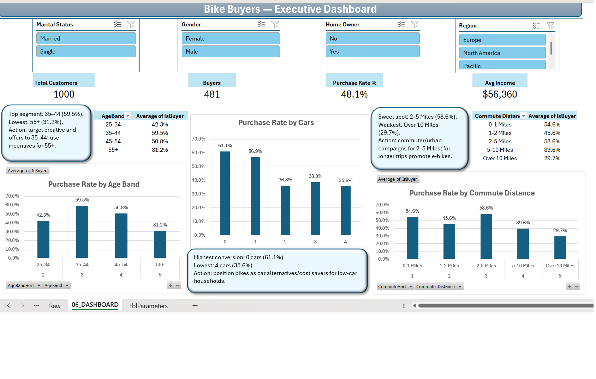

# Bike Buyers — Executive Dashboard (Excel, Power Query)

📄 **[View the one-page PDF dashboard](BikeBuyer_Dashboard.pdf)** · 📊 **[Download the Excel file (.xlsx)](Bike_Buyer_Dashboard.xlsx)**

---

**Goal.** Show professional Excel analytics: automated import (From Folder), feature engineering in Power Query, and an interactive executive dashboard.

## What’s inside
- **ETL (Power Query):** fully parameterised folder path (read from the `tblParameters` table — no hard-coded paths), **Trim & Clean**, typed columns.
- **Features:** `AgeBand`, `AgeBandSort`, `CommuteSort`, `IsBuyer` (Yes → 1, No → 0).
- **Dashboard:** 4 KPIs (Total, Buyers, Purchase Rate %, Avg Income), 3 PivotCharts (by Age Band / Cars / Commute Distance), slicers (Marital Status, Gender, Home Owner, Region).
- **Insight boxes:** dynamic text built with `LET`, `AGGREGATE` and `GETPIVOTDATA` — the highest and lowest segment are found automatically and update with the slicers.

## Data
Source: Kaggle — “Bike Buyers” (1,000 rows).
If the dataset licence restricts redistribution, download it from Kaggle and place the CSV into the `Raw/` folder.

## How to run
1. Clone or download this repo.
2. Open `Bike_Buyer_Dashboard.xlsx`.
3. In sheet **`tblParameters`**, set `DataFolderPath` to your local path of `Raw/`.
4. **Data → Refresh All**.
5. Use the slicers; KPIs, charts, and insight boxes update dynamically.

## Key findings (all customers)
- Overall purchase rate: **48.1%** (481 of 1,000).
- **Age:** highest at **35–44 (59.5%)**, lowest at **55+ (31.2%)**.
- **Cars:** households with **0 cars (61.1%)** and **1 car (56.9%)** convert best; 2+ cars drop to about 36–39%.
- **Commute:** highest at **2–5 miles (58.6%)** and **0–1 miles (54.6%)**; lowest **over 10 miles (29.7%)**.

## Notes
- Drill-down is disabled to avoid stray detail sheets.
- Custom sorting by `AgeBandSort` & `CommuteSort`.
- The PDF (`BikeBuyer_Dashboard.pdf`) is a one-page export (Landscape, Fit to 1 page).
